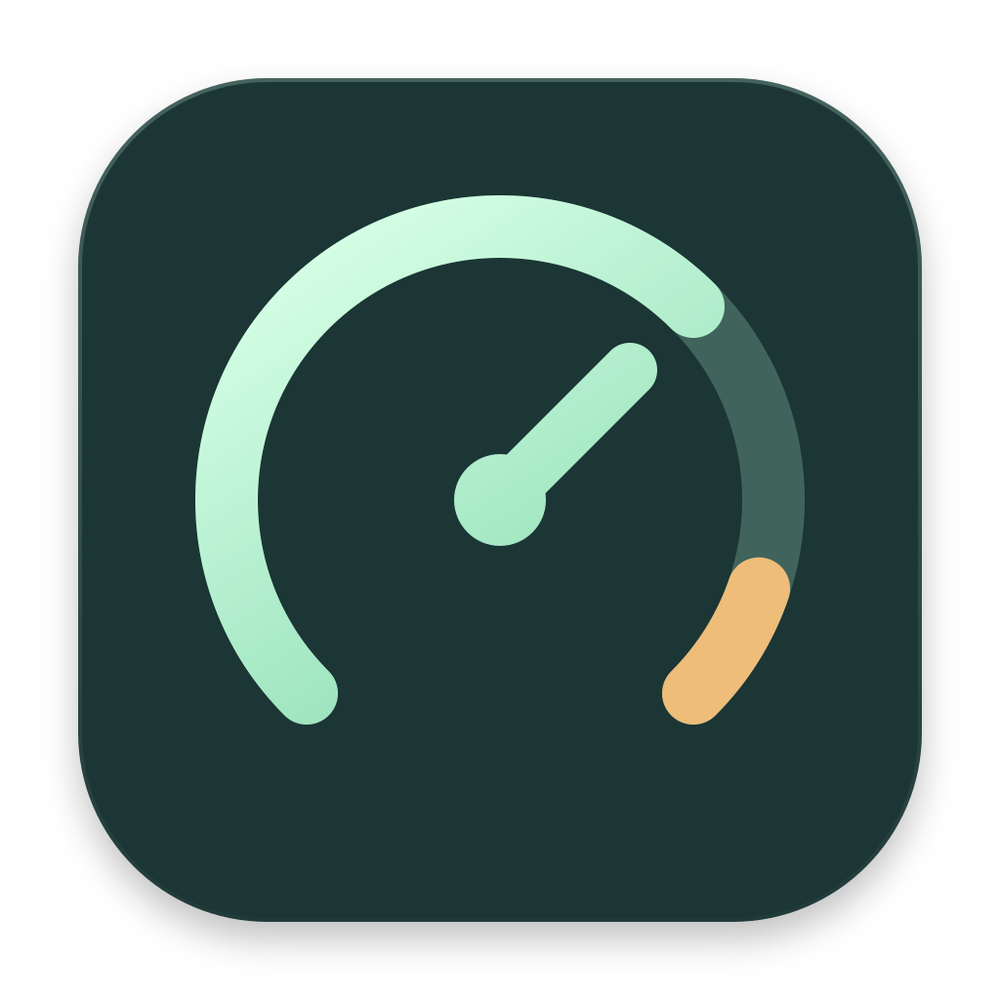
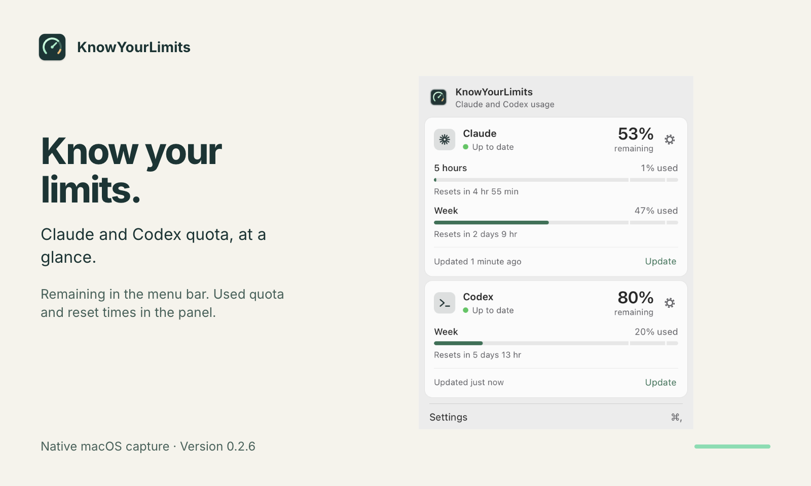
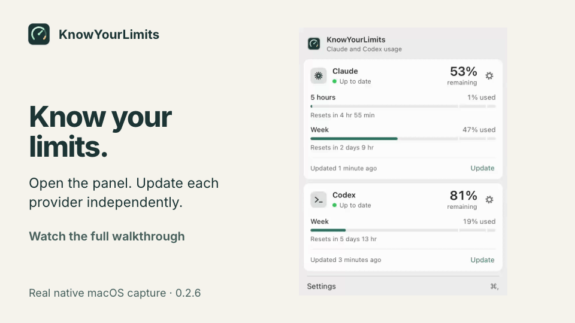
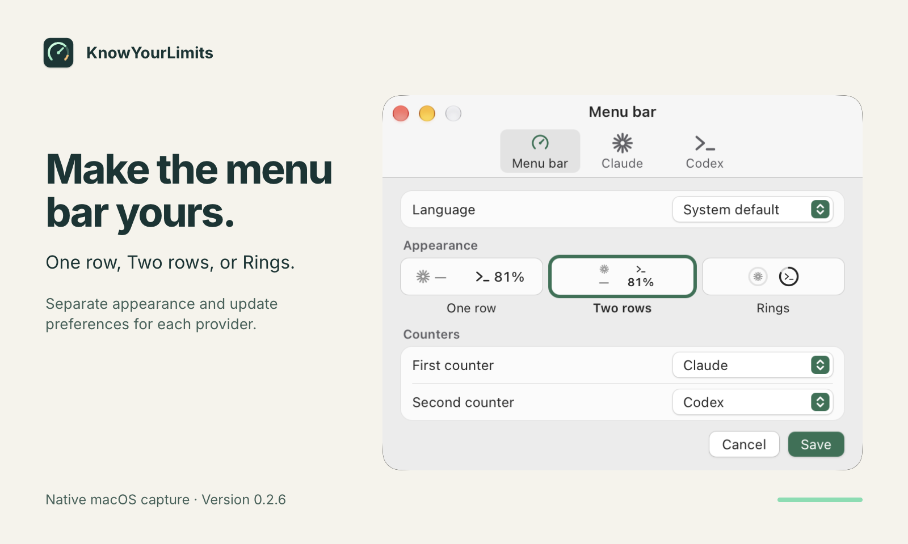

<div align="center">



# KnowYourLimits

**Your Claude and Codex quota, at a glance.**

See your remaining coding quota in the macOS menu bar or Windows tray, with usage and reset times one click away.

macOS 13+ · Apple Silicon &nbsp; | &nbsp; Windows 10/11 · x64 &nbsp; | &nbsp; Source version **0.2.7** <!-- x-release-please-version -->

[Quick tour](#quick-tour) · [Installation](#installation) · [First use](#first-use) · [User guide](docs/usage.md) · [Development](docs/development.md)

</div>



## Features

- **Two providers, separate controls.** Connect Claude Code and Codex independently; update each from its card or the native menu.
- **Remaining quota outside, used quota inside.** Indicators summarize the lowest remaining quota across primary windows. Open the panel for each window's usage and reset time.
- **Refresh on your schedule.** Choose manual updates, fixed intervals, or adaptive 5–15 minute updates. Connections and the last readings persist between launches.
- **Make it yours.** Choose provider order, symbols, colors, and sizes. The interface supports 25 languages: Russian and the 24 official EU languages.
- **Verified app updates.** Check the stable channel, download a signed update, and explicitly install and restart.

| | macOS | Windows |
| --- | --- | --- |
| Indicator | One row, two rows, or rings in the menu bar | Separate Claude and Codex tray rings; percentages in tooltips |
| Appearance | Menu bar layouts and per-provider styling | Rings follow the taskbar theme, including light/dark changes |
| Native notifications | Optional usage, sound, and recovery alerts | Not implemented |

## Quick tour

[](docs/media/tutorial.mp4)

**[Watch the 46-second tutorial](docs/media/tutorial.mp4)** — recorded with Cap
and edited in HyperFrames: read the quota windows, update a provider, preview
menu bar layouts, and explore separate Claude and Codex settings.



Click an indicator to open the quota panel. Each provider card has connection,
update, and settings controls; its gear opens that provider's settings tab.
Right-click an indicator for the native menu.

Follow the [written walkthrough](docs/usage.md#first-use) for sign-in, updates,
and settings, or learn [what the indicators mean](docs/usage.md#reading-the-indicators).

The screenshots show the native macOS app with real readings from authorized
official CLIs. Windows uses the separate tray indicators described above.
See [media provenance and reproducible source](docs/media/README.md) for capture
details and the editable HyperFrames project.

## Installation

> [!NOTE]
> As of October 12, 2026, there are no published releases. Track the first tagged release on [GitHub Releases](https://github.com/bshk-app/KnowYourLimits/releases). Use a source build in the meantime.

With the [platform build prerequisites](docs/development.md#prerequisites) installed:

```sh
git clone https://github.com/bshk-app/KnowYourLimits.git
cd KnowYourLimits
bun install --frozen-lockfile
bun run tauri dev
```

The configured packaging pipeline produces a Developer ID signed, notarized,
stapled DMG for Apple Silicon Macs, plus a Windows installer and portable
executable. Both updater packages have version-bound signatures; Windows
executables currently have no Authenticode publisher signature. See
[local packaging](docs/development.md#packaging) for output paths and requirements.
Intel Macs and Windows ARM64 are not release targets.

## First use

1. **Prepare your CLI.** Install and sign in to the official Codex CLI or Claude Code **2.1.296**. On Windows, use a native Windows installation and sign-in; WSL authorization is separate.
2. **Connect your provider.** Open the panel and select **Connect Codex** or **Connect Claude**. If Claude needs authorization, select **Sign in to Claude** and finish in the browser.
3. **Read and customize.** Check usage and reset times, select **Update** for a new reading, and open the gear to choose appearance and update intervals. Automatic quota refresh and notifications start off.

See the [user guide](docs/usage.md) for CLI discovery, troubleshooting, and macOS
notification setup. Automatic startup is not implemented.

## Limits and privacy

- Values are observations, not a prediction of how many prompts remain. After five minutes, the last reading stays visible as historical data: `~` in menu bar text/tooltips and dashed rings on Windows. `—` means unknown or disconnected, not zero. An elapsed reset time does not create a new measurement.
- Claude requires the pinned CLI's undocumented machine format. When its usage endpoint returns HTTP 429, the app can make a minimal **paid Haiku request** to recover plan windows from response headers. Review the [cost and retry behavior](docs/usage.md#claude-rate-limits-and-cost) before enabling frequent updates.
- Official CLIs handle provider authorization, network requests, and token storage. KnowYourLimits does not open their credential or cookie files. It saves settings, normalized quota snapshots, connections, and retry deadlines locally; no tokens, cookies, or raw CLI logs enter that cache. App update checks contact Zamok with version, platform, and architecture. [Storage and privacy details](docs/usage.md#storage-and-privacy) explain network activity and CLI side effects.

## Documentation

- [User guide](docs/usage.md) — readings, settings, refresh behavior, and troubleshooting.
- [Developer guide](docs/development.md) — setup, native builds, checks, and explicit live readings.
- [Release setup and publishing](docs/publishing.md) — package verification and the configured release workflow.
- [0.2.7 release notes](docs/releases/0.2.7.md) — signed updates, Homebrew, and release distribution.
